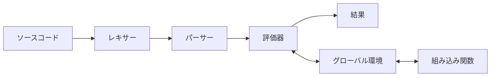

# sucheme-python

**sucheme**はPythonで実装されたR5RS準拠のSchemeインタプリタです。



## 特徴

- **R5RS完全準拠** - R5RS付録マクロまで対応
- **末尾呼び出し最適化（TCO）** - トランポリン方式による無限ループ対応
- **衛生的マクロ（Hygienic Macros）** - `syntax-rules`完全サポート
- **継続（call/cc）** - `call-with-current-continuation`
- **数値タワー** - 整数・有理数・実数・複素数（exact/inexact）
- **インタラクティブREPL** - Emacsキーバインド・補完・履歴
- **Web UI** - ブラウザからSchemeを実行
- **CLI** - コマンドラインからSchemeファイルを実行

## クイックスタート

```bash
# リポジトリのクローン
git clone https://github.com/suchi/sucheme-python.git
cd sucheme-python

# uv がない場合はインストール（グローバルPython環境に影響しません）
pip install uv
# または: curl -LsSf https://astral.sh/uv/install.sh | sh

# 依存関係を解決して仮想環境をセットアップ
uv sync

# REPLを起動
uv run sucheme

# ファイルを実行
uv run sucheme myprogram.scm

# 式を評価
uv run sucheme -e "(display (+ 1 2 3))"

# Web UIを起動
uv run sucheme-web
```

## ドキュメント

| ドキュメント | 説明 |
|-------------|------|
| [オンボーディング](docs/onboarding.md) | 開発環境のセットアップ |
| [SOW](docs/sow.md) | プロジェクト作業範囲定義書 |
| [R5RS対応状況](docs/r5rs-compliance.md) | 標準関数の対応状況 |
| [チュートリアル](docs/tutorial/README.md) | Schemeの学習 |
| [ADR](docs/adr/) | アーキテクチャ決定記録 |

## サンプル

```scheme
; 基本的な算術
(+ 1 2 3)     ; => 6
(* 2 (+ 3 4)) ; => 14

; リスト処理
(map (lambda (x) (* x x)) '(1 2 3 4 5))
; => (1 4 9 16 25)

; 再帰的フィボナッチ
(define (fib n)
  (let loop ((i 0) (a 0) (b 1))
    (if (= i n) a
        (loop (+ i 1) b (+ a b)))))
(fib 10) ; => 55

; 継続による非局所脱出
(define (find-first pred lst)
  (call/cc
    (lambda (return)
      (for-each (lambda (x)
                  (when (pred x) (return x)))
                lst)
      #f)))
(find-first even? '(1 3 4 7)) ; => 4
```

## ライセンス

MIT License

