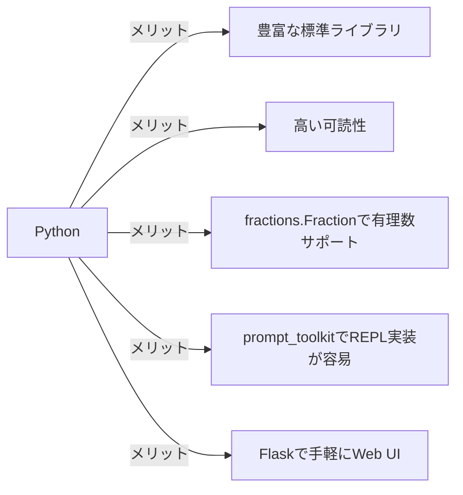

# ADR-0001: Pythonを実装言語として選択

**ステータス**: 承認済み
**日付**: 2026-02-22
**担当**: suchi

## コンテキスト

sucheme-pythonのSchemeインタプリタを実装するにあたり、実装言語を選択する必要がある。

## 決定

**Python 3.10+** を実装言語として選択する。

## 根拠

### 選択の理由

1. **`fractions.Fraction`モジュール**: R5RS の exact rational number を Python ネイティブで表現できる
2. **動的型付け**: Schemeの動的型付けシステムと相性が良い
3. **文字列処理**: Unicodeサポートが充実
4. **エコシステム**: `pytest`, `prompt_toolkit`, `flask` など必要なライブラリが揃っている
5. **可読性**: インタプリタのコードが読みやすく、メンテナンスしやすい

## トレードオフ

| 観点 | Python | 代替（Rust/Go） |
|------|--------|----------------|
| 速度 | ✗ 遅い | ○ 速い |
| 可読性 | ○ 高い | △ 中程度 |
| 開発速度 | ○ 速い | △ 遅い |
| 数値ライブラリ | ○ 充実 | △ 追加実装要 |
| 教育的価値 | ○ 高い | △ 中程度 |

## 影響

- TCO（末尾呼び出し最適化）はPythonの制限により、トランポリン方式で実装する必要がある
- `sys.setrecursionlimit`でPython側の再帰制限を緩和する
- インタプリタの速度はCベースのSchemeより劣るが、教育用途では問題ない
