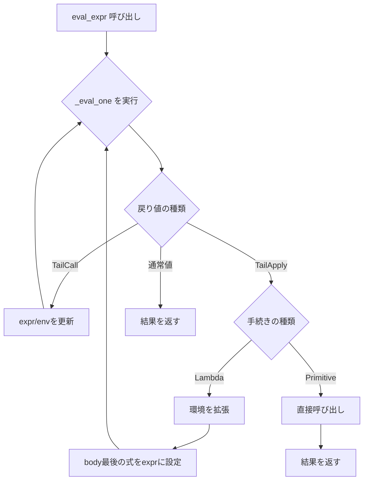

# ADR-0002: トランポリン方式によるTCO実装

**ステータス**: 承認済み
**日付**: 2026-02-22
**担当**: suchi

## コンテキスト

R5RS では末尾呼び出しを必ず最適化（TCO）する必要がある。
Pythonはネイティブで末尾呼び出し最適化をサポートしないため、代替手法が必要。

## 決定

**トランポリン（Trampoline）方式**でTCOを実装する。

## アーキテクチャ



## 実装詳細

```python
class TailCall:
    """末尾式呼び出しのマーカー（TCO用）"""
    def __init__(self, expr, env): ...

class TailApply:
    """末尾適用のマーカー（TCO用）"""
    def __init__(self, proc, args): ...

def eval_expr(expr, env):
    """トランポリン評価ループ"""
    while True:
        result = _eval_one(expr, env)
        if isinstance(result, TailCall):
            expr, env = result.expr, result.env
            # ループ継続（スタックを消費しない）
        elif isinstance(result, TailApply):
            # Lambda の場合は環境を更新してループ継続
            ...
        else:
            return result
```

## 代替案

| 方式 | 利点 | 欠点 |
|------|------|------|
| トランポリン | O(1)スタック | 少し複雑 |
| CPS変換 | 数学的に美しい | 全コードの変換が必要 |
| イテレーション直接変換 | シンプル | 汎用性が低い |
| Python例外 | シンプル | パフォーマンス悪化 |

## 影響

- 全ての評価関数は `TailCall` または `TailApply` を返すことで末尾位置を表現
- `_eval_sequence_tco` で `begin` などの複合式の末尾を処理
- 非末尾再帰はPythonのスタック制限（10000）を受ける
