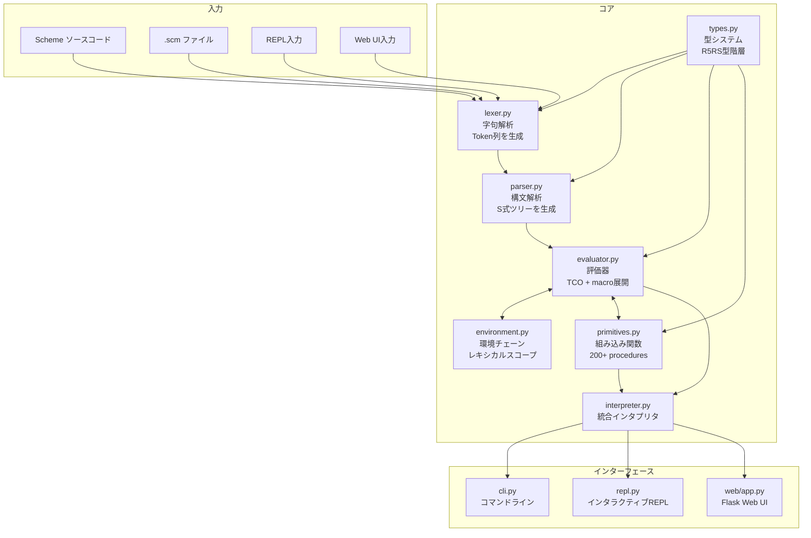
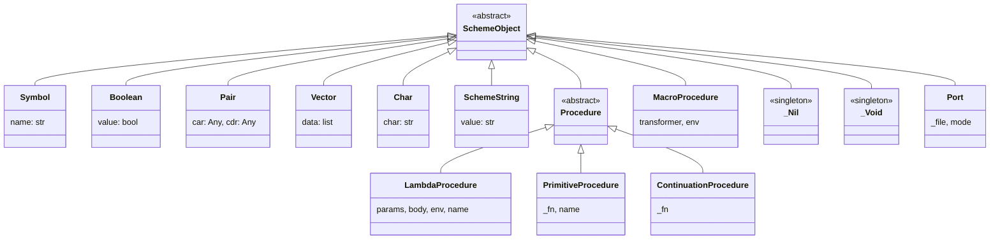
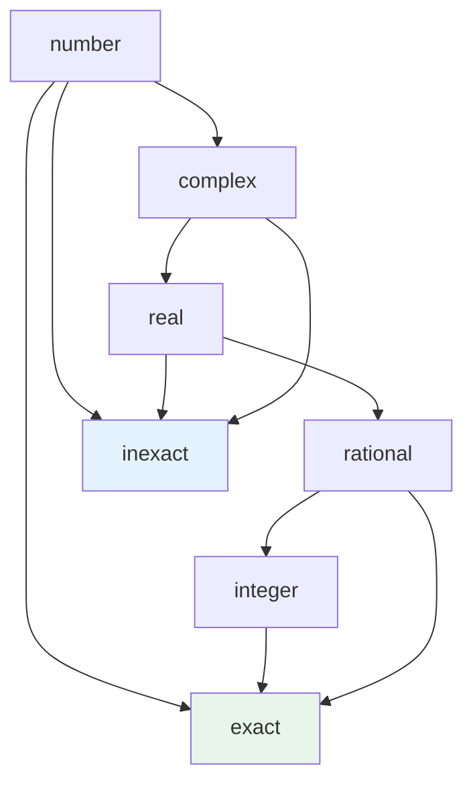
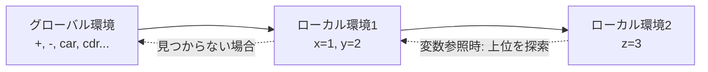
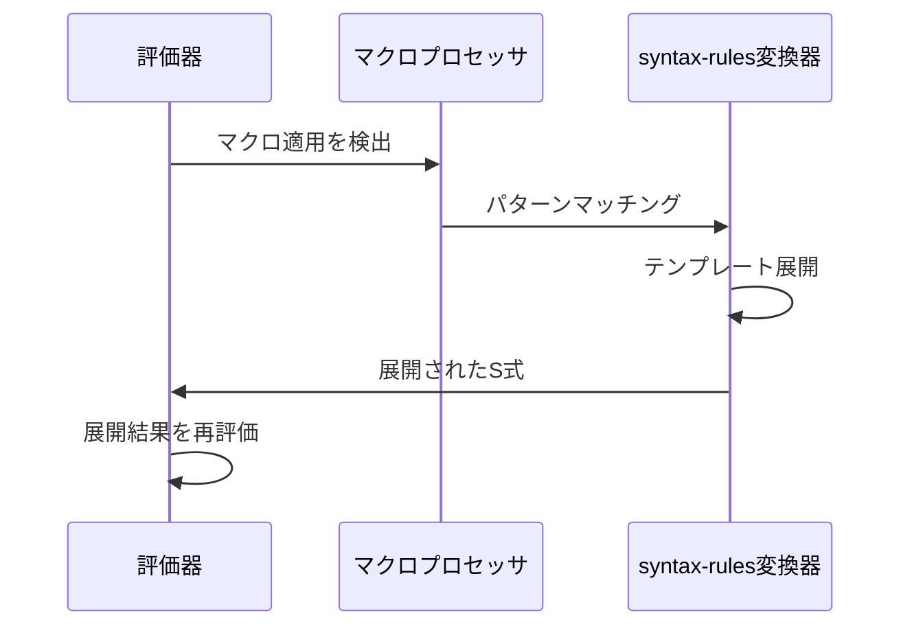

# ADR-0003: アーキテクチャ設計

**ステータス**: 承認済み
**日付**: 2026-02-22
**担当**: suchi

## コンテキスト

R5RS準拠Schemeインタプリタの全体アーキテクチャを設計する。

## 決定

**レキサー → パーサー → 評価器** のパイプライン構造で実装する。
ASTは中間表現を持たず、S式をそのまま評価する（tree-walking interpreter）。

## アーキテクチャ全体図

## 型システム設計

## 数値タワー

| Schemeの型 | Pythonでの表現 |
|-----------|---------------|
| 整数（exact） | `int` |
| 有理数（exact） | `fractions.Fraction` |
| 実数（inexact） | `float` |
| 複素数 | `complex` |

## 環境チェーン（レキシカルスコープ）

## マクロ展開

## 影響

- AST中間表現を持たないため、実装はシンプルだが最適化の余地が少ない
- マクロ展開はインライン（評価時に展開）で行う
- 継続（call/cc）はContinuationException例外でスタックを巻き戻す方式
