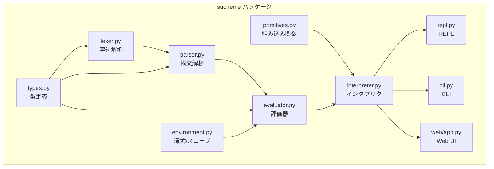
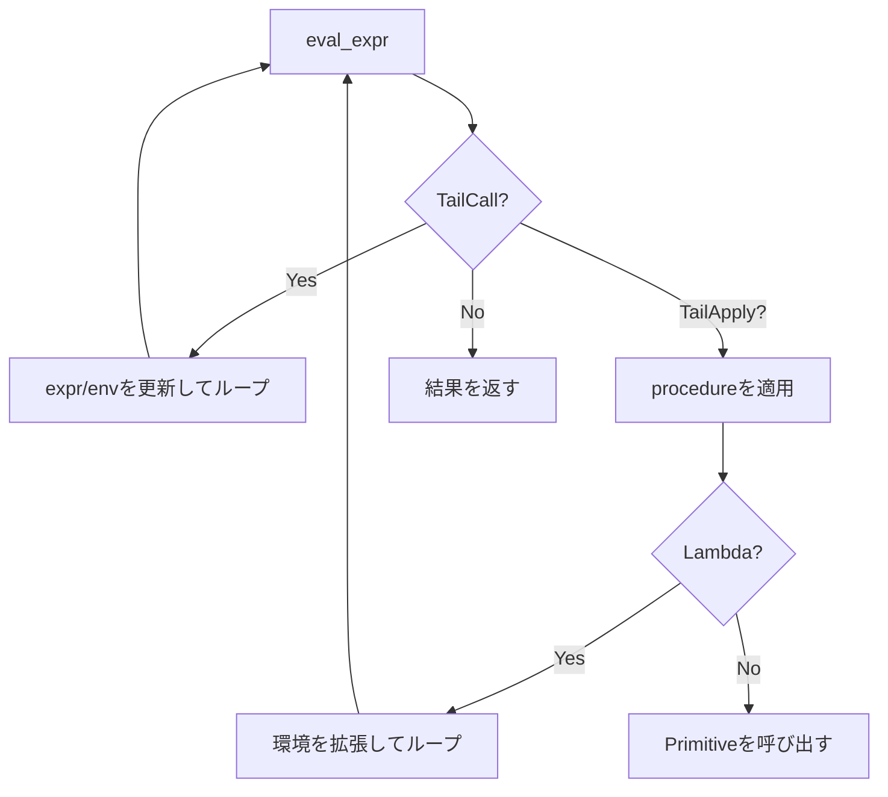
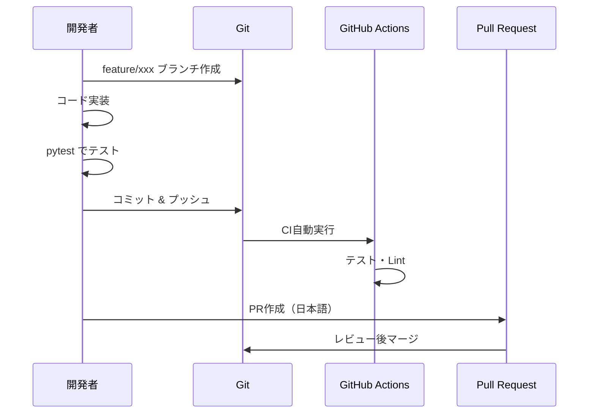

# オンボーディングガイド - sucheme-python

sucheme-python プロジェクトの開発環境構築ガイドです。

## アーキテクチャ概要



## 前提条件

- Python 3.10 以上
- [uv](https://docs.astral.sh/uv/) (推奨) または pip

## セットアップ（uv を使用 — 推奨）

`uv` はグローバルの Python 環境を汚染せず、プロジェクトごとに独立した仮想環境を自動管理します。

```bash
# 0. uv のインストール（未インストールの場合）
pip install uv
# または公式スクリプトでのインストール:
# curl -LsSf https://astral.sh/uv/install.sh | sh  # Linux/macOS
# powershell -c "irm https://astral.sh/uv/install.ps1 | iex"  # Windows

# 1. リポジトリのクローン
git clone https://github.com/suchi/sucheme-python.git
cd sucheme-python

# 2. 開発用依存関係を含む仮想環境を構築
uv sync --dev

# 3. テストの実行
uv run pytest

# 4. カバレッジ付きテスト
uv run pytest --cov=sucheme --cov-report=html
open htmlcov/index.html  # カバレッジレポートを表示
```

## セットアップ（pip を使用）

```bash
# 1. リポジトリのクローン
git clone https://github.com/suchi/sucheme-python.git
cd sucheme-python

# 2. 仮想環境の作成（推奨）
python -m venv .venv
source .venv/bin/activate  # Windows: .venv\Scripts\activate

# 3. 開発用インストール
pip install -e ".[dev]"

# 4. テストの実行
pytest

# 5. カバレッジ付きテスト
pytest --cov=sucheme --cov-report=html
open htmlcov/index.html  # カバレッジレポートを表示
```

## プロジェクト構造

```
sucheme-python/
├── .github/
│   └── workflows/        # GitHub Actions CI/CD
├── docs/
│   ├── adr/              # アーキテクチャ決定記録
│   └── tutorial/         # チュートリアルドキュメント
├── samples/
│   ├── basic/            # 基本サンプル
│   ├── intermediate/     # 中級サンプル
│   └── advanced/         # 上級サンプル
├── sucheme/
│   ├── __init__.py       # パッケージ初期化
│   ├── types.py          # Scheme型定義
│   ├── lexer.py          # 字句解析
│   ├── parser.py         # 構文解析
│   ├── environment.py    # 環境（スコープ）
│   ├── evaluator.py      # 評価器（TCO対応）
│   ├── primitives.py     # 組み込み関数
│   ├── interpreter.py    # インタプリタ（統合）
│   ├── repl.py           # REPL
│   ├── cli.py            # CLIエントリポイント
│   └── web/
│       └── app.py        # Flask Web UI
├── tests/
│   ├── test_lexer.py     # レキサーテスト
│   ├── test_parser.py    # パーサーテスト
│   ├── test_evaluator.py # 評価器テスト
│   └── test_r5rs.py      # R5RS準拠テスト
├── pyproject.toml        # プロジェクト設定
├── .editorconfig         # エディタ設定
└── README.md
```

## コアコンポーネント解説

### types.py - 型システム

SchemeのすべてのデータタイプをPythonクラスで定義します。

```python
# 主要な型
Symbol   # シンボル（インターン済み）
Boolean  # #t / #f（シングルトン）
Pair     # コンスセル
Vector   # ベクタ
Char     # 文字
SchemeString  # 可変文字列
LambdaProcedure   # ユーザー定義関数
PrimitiveProcedure  # 組み込み関数
```

### lexer.py - 字句解析

ソースコードをトークンのリストに変換します。

```python
from sucheme.lexer import tokenize
tokens = tokenize("(+ 1 2)")
# [Token(LPAREN), Token(SYMBOL, '+'), Token(INTEGER, 1), Token(INTEGER, 2), Token(RPAREN)]
```

### evaluator.py - 評価器

末尾呼び出し最適化（TCO）をトランポリン方式で実装しています。



### マクロシステム

`syntax-rules` による衛生的マクロを実装しています。

```scheme
(define-syntax my-and
  (syntax-rules ()
    ((my-and) #t)
    ((my-and e) e)
    ((my-and e1 e2 ...)
     (if e1 (my-and e2 ...) #f))))
```

## 開発ワークフロー



## テスト

```bash
# 全テスト実行
pytest

# 特定のテストファイル
pytest tests/test_lexer.py -v

# カバレッジ付き
pytest --cov=sucheme --cov-report=html

# 特定のテスト
pytest tests/test_evaluator.py::TestArithmetic -v
```

## REPL の使い方

```bash
sucheme          # REPL起動
sucheme script.scm  # ファイル実行
sucheme -e "(+ 1 2)"  # 式評価
```

REPL内コマンド：

| コマンド | 説明 |
|---------|------|
| `,help` | ヘルプ表示 |
| `,quit` | 終了 |
| `,load file.scm` | ファイル読み込み |
| `,env` | 現在の束縛一覧 |

## Web UIの使い方

```bash
sucheme-web              # デフォルト（127.0.0.1:5000）
sucheme-web --port 8080  # ポート指定
sucheme-web --host 0.0.0.0  # 外部公開
```

ブラウザで `http://localhost:5000` を開きます。

## よくある問題

### 再帰深度エラー

非末尾再帰が深すぎる場合に発生します。末尾再帰に書き直してください。

```scheme
; 非末尾再帰（深い再帰でスタックオーバーフロー）
(define (bad-sum n)
  (if (= n 0) 0 (+ n (bad-sum (- n 1)))))

; 末尾再帰（TCOで最適化される）
(define (good-sum n acc)
  (if (= n 0) acc (good-sum (- n 1) (+ acc n))))
```

### マクロの衛生性

`syntax-rules` では束縛の衛生性が保証されます。

```scheme
(define-syntax swap!
  (syntax-rules ()
    ((swap! a b)
     (let ((tmp a))   ; tmp は衛生的（外部のtmpを汚染しない）
       (set! a b)
       (set! b tmp)))))
```
