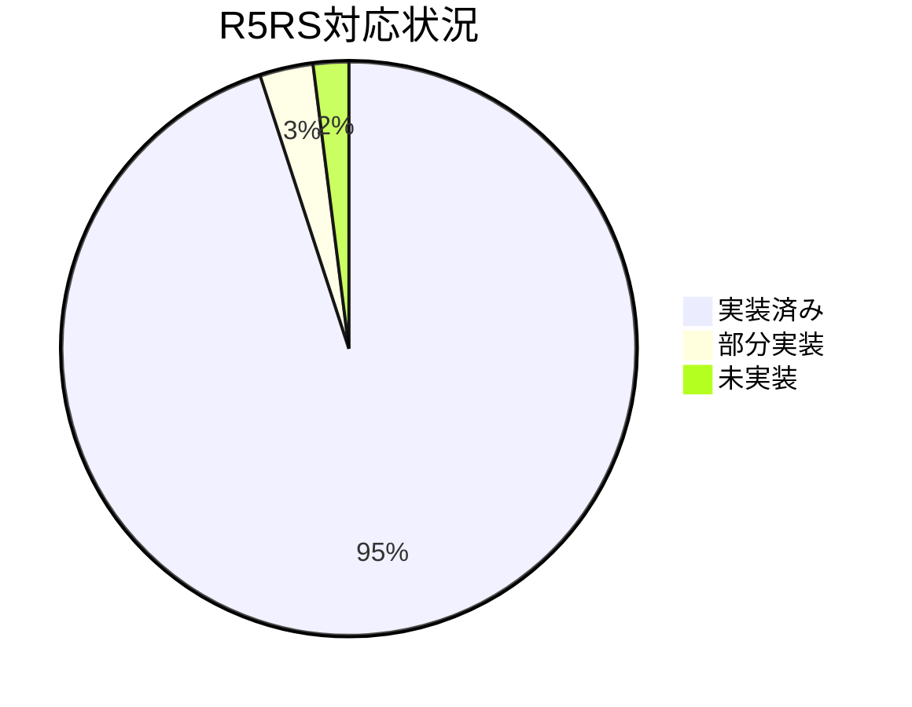

# R5RS 対応状況表

sucheme における R5RS（Revised⁵ Report on Scheme）の実装状況です。

凡例: ✅ 実装済み / ⚠️ 部分実装 / ❌ 未実装

## 6.1 等価性述語

| 手続き | 対応 | 備考 |
|--------|------|------|
| `eq?` | ✅ | |
| `eqv?` | ✅ | |
| `equal?` | ✅ | |

## 6.2.5 数値演算

| 手続き | 対応 | 備考 |
|--------|------|------|
| `number?` | ✅ | |
| `complex?` | ✅ | |
| `real?` | ✅ | |
| `rational?` | ✅ | |
| `integer?` | ✅ | |
| `exact?` | ✅ | |
| `inexact?` | ✅ | |
| `=` `<` `>` `<=` `>=` | ✅ | 可変長引数対応 |
| `zero?` `positive?` `negative?` | ✅ | |
| `odd?` `even?` | ✅ | |
| `max` `min` | ✅ | |
| `+` `-` `*` `/` | ✅ | 正確な有理数算術 |
| `abs` | ✅ | |
| `quotient` `remainder` `modulo` | ✅ | |
| `gcd` `lcm` | ✅ | |
| `numerator` `denominator` | ✅ | |
| `floor` `ceiling` `truncate` `round` | ✅ | |
| `rationalize` | ⚠️ | 近似実装 |
| `exp` `log` `sin` `cos` `tan` | ✅ | |
| `asin` `acos` `atan` | ✅ | 1引数・2引数対応 |
| `sqrt` | ✅ | exact整数に対しexact結果 |
| `expt` | ✅ | |
| `make-rectangular` `make-polar` | ✅ | |
| `real-part` `imag-part` | ✅ | |
| `magnitude` `angle` | ✅ | |
| `exact->inexact` | ✅ | |
| `inexact->exact` | ✅ | |
| `number->string` | ✅ | 基数指定対応 |
| `string->number` | ✅ | 基数指定対応 |

## 6.3 その他のデータ型

### 6.3.1 ブール値

| 手続き/構文 | 対応 | 備考 |
|------------|------|------|
| `not` | ✅ | |
| `boolean?` | ✅ | |
| `boolean=?` | ✅ | |

### 6.3.2 ペアとリスト

| 手続き | 対応 | 備考 |
|--------|------|------|
| `pair?` | ✅ | |
| `cons` | ✅ | |
| `car` `cdr` | ✅ | |
| `set-car!` `set-cdr!` | ✅ | |
| `caar` `cadr` ... `cddddr` | ✅ | 全組み合わせ |
| `null?` | ✅ | |
| `list?` | ✅ | 循環検出付き |
| `list` | ✅ | |
| `length` | ✅ | |
| `append` | ✅ | |
| `reverse` | ✅ | |
| `list-tail` | ✅ | |
| `list-ref` | ✅ | |
| `memq` `memv` `member` | ✅ | |
| `assq` `assv` `assoc` | ✅ | |

### 6.3.3 シンボル

| 手続き | 対応 | 備考 |
|--------|------|------|
| `symbol?` | ✅ | |
| `symbol->string` | ✅ | |
| `string->symbol` | ✅ | |

### 6.3.4 文字

| 手続き | 対応 | 備考 |
|--------|------|------|
| `char?` | ✅ | |
| `char=?` `char<?` `char>?` `char<=?` `char>=?` | ✅ | |
| `char-ci=?` `char-ci<?` ... | ✅ | 大小文字無視比較 |
| `char-alphabetic?` `char-numeric?` `char-whitespace?` | ✅ | |
| `char-upper-case?` `char-lower-case?` | ✅ | |
| `char->integer` `integer->char` | ✅ | |
| `char-upcase` `char-downcase` | ✅ | |

### 6.3.5 文字列

| 手続き | 対応 | 備考 |
|--------|------|------|
| `string?` | ✅ | |
| `make-string` | ✅ | |
| `string` | ✅ | |
| `string-length` | ✅ | |
| `string-ref` | ✅ | |
| `string-set!` | ✅ | |
| `string=?` `string<?` ... | ✅ | |
| `string-ci=?` `string-ci<?` ... | ✅ | |
| `substring` | ✅ | |
| `string-append` | ✅ | |
| `string->list` | ✅ | |
| `list->string` | ✅ | |
| `string-copy` | ✅ | |
| `string-fill!` | ✅ | |

### 6.3.6 ベクタ

| 手続き | 対応 | 備考 |
|--------|------|------|
| `vector?` | ✅ | |
| `make-vector` | ✅ | |
| `vector` | ✅ | |
| `vector-length` | ✅ | |
| `vector-ref` | ✅ | |
| `vector-set!` | ✅ | |
| `vector->list` | ✅ | |
| `list->vector` | ✅ | |
| `vector-fill!` | ✅ | |

## 6.4 制御フィーチャー

| 手続き | 対応 | 備考 |
|--------|------|------|
| `procedure?` | ✅ | |
| `apply` | ✅ | 可変引数対応 |
| `map` | ✅ | 複数リスト対応 |
| `for-each` | ✅ | 複数リスト対応 |
| `force` | ✅ | |
| `call-with-current-continuation` | ✅ | |
| `call/cc` | ✅ | エイリアス |
| `values` | ✅ | |
| `call-with-values` | ✅ | |
| `dynamic-wind` | ✅ | |

## 6.5 eval

| 手続き | 対応 | 備考 |
|--------|------|------|
| `eval` | ✅ | |
| `scheme-report-environment` | ✅ | |
| `null-environment` | ✅ | |
| `interaction-environment` | ✅ | |

## 6.6 入出力

| 手続き | 対応 | 備考 |
|--------|------|------|
| `call-with-input-file` | ✅ | |
| `call-with-output-file` | ✅ | |
| `input-port?` `output-port?` | ✅ | |
| `current-input-port` `current-output-port` | ✅ | |
| `with-input-from-file` | ✅ | |
| `with-output-to-file` | ✅ | |
| `open-input-file` `open-output-file` | ✅ | |
| `close-input-port` `close-output-port` | ✅ | |
| `read` | ✅ | |
| `read-char` | ✅ | |
| `peek-char` | ⚠️ | 簡易実装 |
| `eof-object?` | ✅ | |
| `char-ready?` | ✅ | |
| `write` | ✅ | |
| `display` | ✅ | |
| `newline` | ✅ | |
| `write-char` | ✅ | |
| `load` | ✅ | |
| `transcript-on` `transcript-off` | ❌ | |

## R5RS 付録 - 派生式構文（マクロで実装）

| 構文 | 対応 | 実装方法 |
|------|------|---------|
| `cond` | ✅ | syntax-rules マクロ |
| `case` | ✅ | syntax-rules マクロ |
| `and` | ✅ | syntax-rules マクロ |
| `or` | ✅ | syntax-rules マクロ |
| `when` | ✅ | syntax-rules マクロ |
| `unless` | ✅ | syntax-rules マクロ |
| `let` | ✅ | syntax-rules マクロ（named let含む） |
| `let*` | ✅ | syntax-rules マクロ |
| `letrec` | ✅ | syntax-rules マクロ |
| `letrec*` | ✅ | syntax-rules マクロ |
| `do` | ✅ | 組み込み特殊形式 |
| `delay` | ✅ | syntax-rules マクロ |
| `delay-force` | ✅ | syntax-rules マクロ |
| `quasiquote` | ✅ | 組み込み特殊形式 |
| `parameterize` | ✅ | syntax-rules マクロ |
| `guard` | ✅ | syntax-rules マクロ |
| `define-record-type` | ✅ | 組み込み特殊形式 |
| `define-syntax` | ✅ | 組み込み特殊形式 |
| `let-syntax` | ✅ | 組み込み特殊形式 |
| `letrec-syntax` | ✅ | 組み込み特殊形式 |
| `syntax-rules` | ✅ | パターンマッチング+省略記号 |

## 拡張機能（R5RS外）

| 機能 | 説明 |
|------|------|
| `format` | Gauche互換フォーマット文字列 |
| `filter` | リストのフィルタリング |
| `fold-left` `fold-right` | リストの畳み込み |
| `sort` | リストのソート |
| `iota` | 数列の生成 |
| `string-split` | 文字列の分割 |
| `hash-table` | ハッシュテーブル |
| `make-parameter` | パラメータオブジェクト |
| `gensym` | 一意シンボル生成 |
| `receive` | SRFI-8 多値受け取り |

## 対応状況サマリー

| カテゴリ | 実装済み | 部分実装 | 未実装 |
|---------|---------|---------|-------|
| 等価性述語 | 3/3 | - | - |
| 数値 | 45/46 | 1 | - |
| ブール値 | 3/3 | - | - |
| ペア・リスト | 16/16 | - | - |
| シンボル | 3/3 | - | - |
| 文字 | 14/14 | - | - |
| 文字列 | 14/14 | - | - |
| ベクタ | 9/9 | - | - |
| 制御 | 10/10 | - | - |
| eval | 4/4 | - | - |
| 入出力 | 18/20 | 1 | 1 |
| 付録マクロ | 19/19 | - | - |
| **合計** | **158/161** | **2** | **1** |
