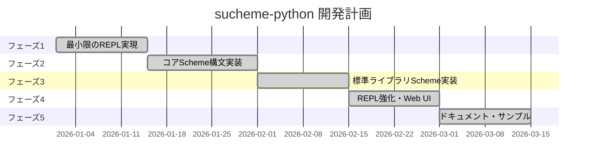

# SOW（作業範囲定義書）- sucheme-python

## プロジェクト概要

PythonでR5RS準拠のSchemeインタプリタ「sucheme-python」を実装する。

## 目標

R5RSに完全準拠したSchemeインタプリタをPythonで実装し、教育・研究用途で使えるツールを提供する。

## フェーズ

## フェーズ1: 最小限のREPL

**目標**: `(+ 1 2)` が動く最小限のインタプリタ

- レキサー（字句解析器）
- パーサー（構文解析器）
- 基本評価器（数値・変数・関数適用）
- シンプルなREPL

**成果物**: `sucheme/lexer.py`, `sucheme/parser.py`, `sucheme/evaluator.py`, `sucheme/repl.py`

## フェーズ2: コアScheme構文

**目標**: R5RS の全基本構文の実装

| 機能 | 実装 |
|------|------|
| `define`, `set!` | 変数束縛・代入 |
| `lambda` | クロージャ |
| `if`, `cond`, `case` | 条件式 |
| `let`, `let*`, `letrec` | ローカル束縛 |
| `begin` | 順次実行 |
| `do` | ループ |
| `define-syntax`, `syntax-rules` | マクロ |
| `call/cc` | 継続 |
| `values`, `call-with-values` | 多値 |
| `delay`, `force` | 遅延評価 |
| `define-record-type` | レコード型 |

**成果物**: `sucheme/evaluator.py`（完全実装）

## フェーズ3: 組み込み関数

**目標**: R5RS の全組み込み関数の実装

- 等価性述語（`eq?`, `eqv?`, `equal?`）
- 数値（算術、比較、変換）
- 文字列、文字、ベクタ
- リスト処理（`map`, `filter`, `fold`等）
- 入出力（ポート、ファイル）
- 制御（`apply`, `for-each`）

**成果物**: `sucheme/primitives.py`

## フェーズ4: REPL強化・外部インタフェース

**目標**: 使いやすい開発環境

- prompt_toolkit による高機能REPL（補完、Emacsキーバインド）
- Flask Web UI
- CLI（argparse、標準オプション）

**成果物**: `sucheme/repl.py`, `sucheme/web/app.py`, `sucheme/cli.py`

## フェーズ5: ドキュメント・テスト・サンプル

**目標**: 学習・利用しやすいエコシステム

- オンボーディングドキュメント
- ADR（アーキテクチャ決定記録）
- R5RS対応状況表
- 100以上のサンプルプログラム
- テストカバレッジ（pytest-cov）
- CI/CD（GitHub Actions）

## 技術スタック

| 分類 | 技術 |
|------|------|
| 言語 | Python 3.10+ |
| REPL | prompt_toolkit 3.0 |
| Web UI | Flask 3.0 |
| テスト | pytest + pytest-cov |
| CI/CD | GitHub Actions |
| パッケージング | pyproject.toml (setuptools) |

## 受入条件

- [ ] R5RS の全必須機能を実装
- [ ] 全テスト通過（pytest）
- [ ] テストカバレッジ 80%以上
- [ ] 100以上のサンプルプログラム
- [ ] GitHub Actions CI/CDが動作する
- [ ] Web UIから基本的なSchemeが実行できる
- [ ] `sucheme` コマンドで標準的なオプションが使える

## リスク

| リスク | 対策 |
|--------|------|
| TCO実装の複雑さ | トランポリン方式で対応 |
| 衛生的マクロの正確性 | テストケースを充実させる |
| Pythonの再帰深度制限 | sys.setrecursionlimit を調整 |
